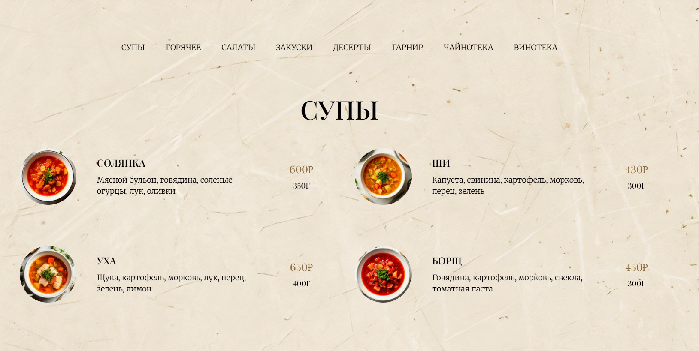
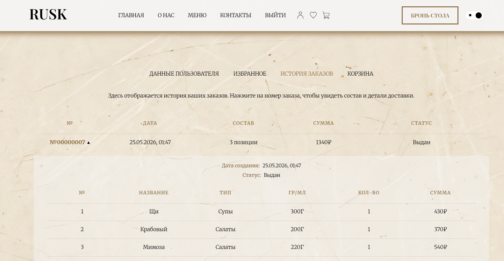
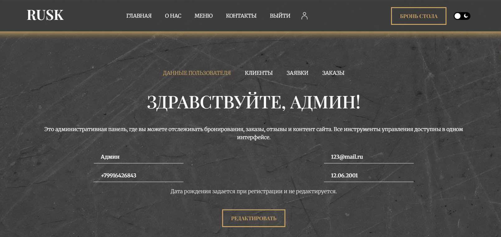
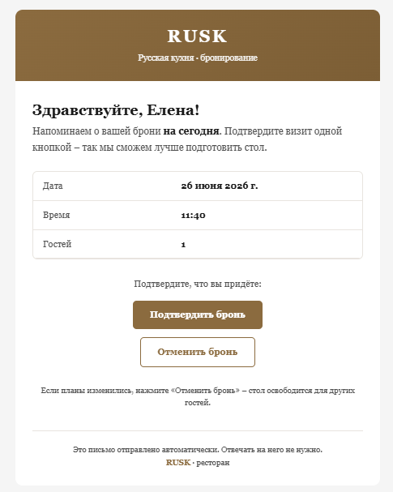

# RUSK — веб-сайт ресторана

Полнофункциональное веб-приложение для ресторана: онлайн-бронирование, заказы, личные кабинеты клиента и администратора, email-уведомления.

> Дипломный / учебный fullstack-проект. Демо: скриншоты ниже (или видео). Запуск локальный по инструкции.


## Стек
| Часть    | Технологии                           |
| -------- | ------------------------------------ |
| Frontend | React, Vite, React Router, Bootstrap |
| Backend  | Node.js, Express.js, REST API        |
| БД       | MySQL                                |
| Auth     | JWT, bcrypt                          |
| Прочее   | Nodemailer, Multer, node-cron        |


## Что реализовано
- Адаптивный интерфейс (desktop / mobile), UI-kit, светлая и темная тема  
- Регистрация и вход (валидация email, телефона, пароля; 18+)  
- Меню по категориям, избранное, корзина, оформление заказа  
- Онлайн-бронирование столиков  
- Личный кабинет клиента: профиль, история заказов, избранное  
- Админ-панель: клиенты, заявки на бронь, заказы, управление меню  
- Email-уведомления по заказам / бронированиям  
- Разграничение ролей (`client` / `admin`), защищенные маршруты


## Скриншоты







[Смотреть демо (4 мин)](https://drive.google.com/file/d/1CdpqvDypvxFX1uzwq74q9ZxDHX9j62r8/view?usp=sharing)


## Структура проекта
```
rusk/
├── frontend/     # React (Vite)
├── backend/      # Express API
├── rusk.sql      # Дамп БД
└── deploy.sh     # Деплой на сервер
```

## Запуск локально


### Требования
- Node.js 18+
- MySQL

### 1. База данных
Создайте БД и импортируйте дамп:

```bash
mysql -u root -p < rusk.sql
```

### 2. Backend
```bash
cd backend
cp .env.example .env
# заполните DB_*, JWT_SECRET и настройки почты при необходимости
npm install
npm run dev
```

API по умолчанию: `http://localhost:4000`

### 3. Frontend
```bash
cd frontend
npm install
npm run dev
```

### 4. Оба сразу (из корня)
```bash
npm install
npm run dev
```


## Роль в проекте
Самостоятельная разработка: анализ требований, проектирование (IDEF0, Use Case, диаграмма классов), UI/UX, frontend, backend, БД, деплой.


## Возможное развитие
- Онлайн-оплата  
- Программа лояльности / промокоды  
- SMS / push-уведомления  
- Аналитика заказов и загрузки зала